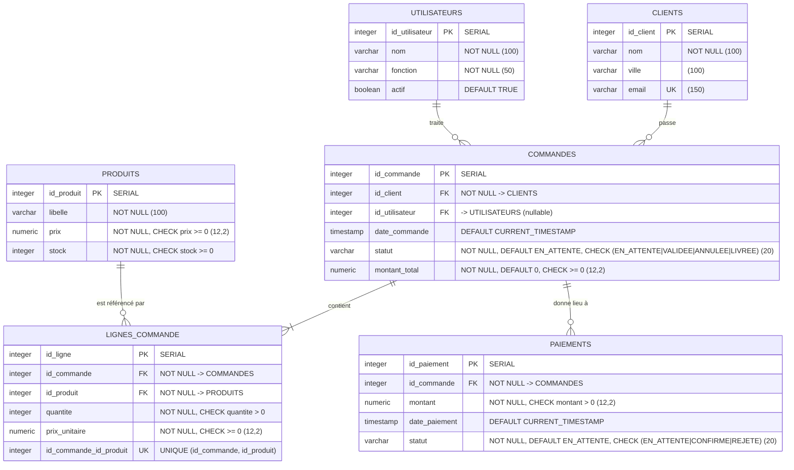
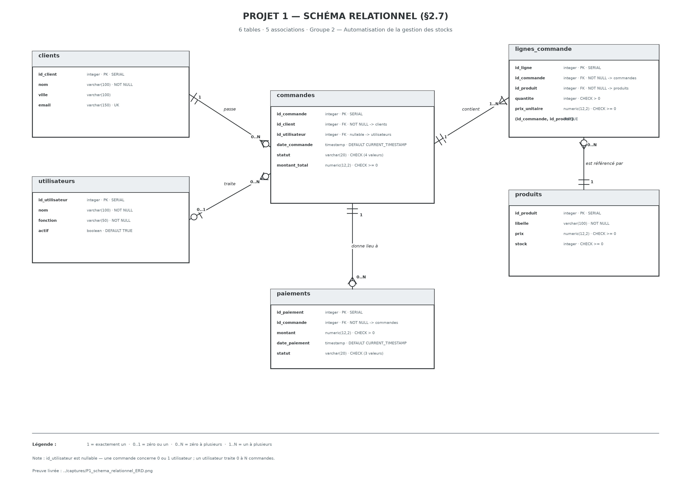

# Projet 1 — PostgreSQL local : schéma relationnel et rapport (partie commune)

**ITT3-IR — Groupe 2 — Rôle M1 (Chef d'équipe) : KEUMEKA SOKING WILFRIED GULLIT**

> Ce document contient (1) le diagramme ERD complet demandé en §2.7 et (2) le texte explicatif prêt à copier pour la partie commune §1 à §3.

---

## 1. Diagramme ERD — §2.7 (6 tables, 5 associations)



### Version image haute résolution (preuve livrée)



Fichier : `../captures/P1_schema_relationnel_ERD.png` (6 tables, 5 associations, fond blanc, traits gris foncé).

### Légende des 5 associations

| # | Association | Cardinalité | Clé étrangère | Explication |
|---|---|---|---|---|
| 1 | `CLIENTS` → `COMMANDES` | 1,N | `commandes.id_client` | Un client peut passer 0 à n commandes ; chaque commande appartient à un seul client. |
| 2 | `UTILISATEURS` → `COMMANDES` | 1,N | `commandes.id_utilisateur` | Un utilisateur peut traiter 0 à n commandes ; l'utilisateur est facultatif sur une commande. |
| 3 | `COMMANDES` → `LIGNES_COMMANDE` | 1,N | `lignes_commande.id_commande` | Une commande contient au moins une ligne ; une ligne appartient à une seule commande. |
| 4 | `PRODUITS` → `LIGNES_COMMANDE` | 1,N | `lignes_commande.id_produit` | Un produit peut apparaître dans plusieurs lignes ; une ligne référence un seul produit. |
| 5 | `COMMANDES` → `PAIEMENTS` | 1,N | `paiements.id_commande` | Une commande peut donner lieu à 0 à n paiements (acompte, solde, rejet). |

> Contrainte d'intégrité complémentaire : `UNIQUE (id_commande, id_produit)` interdit de saisir deux fois le même produit dans une même commande.

---

## 2. Texte prêt à copier — Partie commune, §1 à §3

### §1. Contexte et objectifs du projet

Le présent projet s'inscrit dans le cadre du module ITT3-IR (Groupe 2). Il a pour objectif de mettre en œuvre, à partir d'un besoin métier simulé de gestion commerciale, une chaîne complète de traitement de données : modélisation relationnelle, implémentation sous PostgreSQL, exploitation par requêtes SQL, puis restitution des résultats. Trois projets complémentaires sont menés par l'équipe : **Projet 1 — PostgreSQL local**, **Projet 2 — MongoDB** et **Projet 3 — RStudio**. Le rôle de chef d'équipe (M1) est assuré par KEUMEKA SOKING WILFRIED GULLIT ; il coordonne la structuration des livrables, la cohérence des schémas et la capitalisation des preuves d'exécution.

Le périmètre du Projet 1 se limite volontairement à une instance PostgreSQL **locale, hors Docker**. Ce choix garantit une reproductibilité immédiate sur le poste de travail, sans dépendance à un moteur de conteneurisation, tout en conservant la possibilité de basculer ultérieurement vers une image `pgvector/pgvector` si le besoin de recherche vectorielle se confirme.

Les résultats attendus sont les suivants :

1. une base `entreprise_tp` recréée de façon idempotente et peuplée de données de démonstration conformes au sujet ;
2. un schéma relationnel normalisé de six tables, accompagné de l'ensemble de ses contraintes d'intégrité ;
3. un diagramme ERD commenté (§2.7) et un script socle versionné dans `Projet1_PostgreSQL/scripts/` ;
4. des captures d'exécution `psql` conservées dans `Projet1_PostgreSQL/captures/` comme preuves pour le rapport.

### §2. Analyse des besoins et modélisation

#### §2.1 Identification des acteurs et des objets métier

L'analyse du besoin met en évidence six objets métier principaux :

- **Client** : identifiant, nom, ville et adresse e-mail unique. Il est à l'origine des commandes.
- **Utilisateur** : identifiant, nom, fonction et statut actif. Il représente un membre de l'équipe qui traite les commandes.
- **Produit** : identifiant, libellé, prix unitaire et stock disponible. Les deux grandeurs numériques sont soumises à une contrainte de non-négativité.
- **Commande** : identifiant, client, utilisateur éventuel, date, statut et montant total. Le statut est un domaine fermé à quatre valeurs (`EN_ATTENTE`, `VALIDEE`, `ANNULEE`, `LIVREE`).
- **Ligne de commande** : identifiant, commande, produit, quantité et prix unitaire. Elle constitue la table de liaison many-to-many entre commandes et produits, avec unicité du couple `(id_commande, id_produit)`.
- **Paiement** : identifiant, commande, montant, date et statut (`EN_ATTENTE`, `CONFIRME`, `REJETE`). Un montant strictement positif est exigé.

#### §2.2 Règles de gestion et contraintes

Les règles de gestion sont traduites directement en contraintes SQL : clés primaires sur tous les identifiants, clés étrangères pour les références, contraintes `CHECK` sur les domaines de statuts et sur les valeurs numériques, `UNIQUE` sur l'e-mail client et sur le couple commande/produit, et valeurs par défaut pour les dates, les statuts et le drapeau `actif`. Cette approche garantit que l'intégrité est vérifiée par le moteur de base de données lui-même, et non uniquement par le code applicatif.

#### §2.3 Choix de conception

Le type `SERIAL` est retenu pour les clés primaires afin de simplifier la génération des identifiants. Les montants utilisent `NUMERIC(12,2)` plutôt qu'un type flottant, afin d'éviter les erreurs d'arrondi sur les calculs financiers. Les statuts sont stockés en `VARCHAR(20)` avec une contrainte `CHECK`, ce qui offre un bon compromis entre lisibilité et simplicité pour un volume de données de démonstration.

#### §2.4 Normalisation

Le schéma est en troisième forme normale (3FN) : chaque table décrit un seul concept, les dépendances fonctionnelles portent sur la clé primaire, et aucune information redondante n'est stockée. Le montant total de la commande constitue une exception volontaire, héritée du sujet : il est conservé tel que fourni pour les besoins de l'énoncé, même si une valeur calculée à partir des lignes serait plus sûre en production.

#### §2.5 Données initiales

Le jeu de données de démonstration comprend 5 clients, 4 utilisateurs, 5 produits, 5 commandes, 10 lignes de commande et 5 paiements. Il couvre l'ensemble des statuts prévus et permet de valider les contraintes aussi bien en insertion qu'en consultation.

#### §2.6 Correction des fautes de frappe du PDF

Les noms de tables et de colonnes du sujet ont été normalisés sans changer leur sens : `utilisateurs` (au lieu de variantes accentuées ou fautives), `lignes_commande` (au lieu de `lignes_commandes`), `date_commande`, `date_paiement`, `montant_total` et `prix_unitaire`. Les statuts `VALIDEE`, `ANNULEE`, `CONFIRME` et `REJETE` sont repris à l'identique de l'énoncé, sans accent, afin de respecter strictement le domaine attendu par les contraintes `CHECK`.

#### §2.7 Diagramme entité-relationnel

Le diagramme ERD complet (six entités, cinq associations) est présenté en tête de ce document et livré en image haute résolution dans `../captures/P1_schema_relationnel_ERD.png`. Il est directement rendable par Mermaid dans tout éditeur Markdown compatible.

#### §2.8 Remarque de contrôle qualité sur les données du sujet

Les données initiales sont insérées **exactement telles qu'elles figurent dans l'énoncé**. Une incohérence a toutefois été identifiée et doit être signalée dans le rapport : la commande n° 3 porte un `montant_total` de **97 000**, alors que la somme de ses trois lignes (85 000 + 8 000 + 12 000) s'élève à **105 000**. L'écart est de 8 000. Ce constat n'a pas été corrigé unilatéralement afin de préserver la conformité avec le sujet ; il illustre l'importance des contrôles de réconciliation entre en-tête et lignes de commande.

### §3. Environnement technique et choix d'implémentation

#### §3.1 Plateforme

Les travaux sont réalisés sous **Windows (PowerShell 5.1)** avec une instance **PostgreSQL 18** installée localement (`C:\Program Files\PostgreSQL\18\bin`), service `postgresql-x64-18` démarré en mode automatique et écoutant sur `localhost:5432`. Aucun conteneur Docker n'est sollicité pour le Projet 1. Les commandes `psql` et `pg_isready` sont appelées avec leur chemin absolu, car le répertoire `bin` n'est pas présent dans la variable `PATH` de la session.

#### §3.2 Organisation des livrables

L'arborescence standard de l'équipe est respectée pour chaque projet :

```text
Projets_ITT3_IR/
├── Projet1_PostgreSQL/
│   ├── scripts/        # P1_01_socle_GULLIT.sql
│   ├── captures/       # P1_01_socle_output.txt
│   ├── rapport/        # P1_schema_relationnel_GULLIT.md
│   └── presentation/
├── Projet2_MongoDB/
│   └── ...
└── Projet3_RStudio/
    ├── scripts/        # jeu_donnees_clients_telecom.csv
    └── ...
```

Le fichier `Dataset_Analyses_donnees.csv` a été copié vers `Projet3_RStudio/scripts/jeu_donnees_clients_telecom.csv` ; l'intégrité de la copie a été vérifiée par comparaison des empreintes SHA-256.

#### §3.3 Idempotence et reproductibilité

Le script socle commence par `DROP DATABASE IF EXISTS entreprise_tp; CREATE DATABASE entreprise_tp;`, puis se reconnecte avec `\c entreprise_tp`. Il peut donc être rejoué à l'identique après chaque modification. La directive `\set ON_ERROR_STOP on` arrête immédiatement l'exécution en cas d'erreur, ce qui évite de laisser une base partiellement chargée. Enfin, les séquences `SERIAL` sont resynchronisées sur les identifiants insérés explicitement.

#### §3.4 Extension pgvector — diagnostic et décision

**Résultat du diagnostic exécuté sur l'instance locale (PostgreSQL 18.4) :**

```sql
SELECT name, default_version, installed_version, comment
FROM pg_available_extensions
WHERE name = 'vector';
-- >>> 0 ligne
```

L'extension `vector` est donc **absente de l'instance locale**. En complément, les fichiers `C:\Program Files\PostgreSQL\18\lib\vector.dll` et `C:\Program Files\PostgreSQL\18\share\extension\vector.control` n'existent pas, et `pg_extension` ne contient que `plpgsql`. La présence du dossier source `C:\Users\Wilfried\pgvector` (version **0.8.7**) ne suffit pas : il faut compiler/installer, ou utiliser l'image Docker.

**Option A — Activer pgvector sur PostgreSQL 18 local (compilation depuis les sources 0.8.7)**

1. Ouvrir le **« x64 Native Tools Command Prompt for VS »** (compilateur MSVC, même famille que celui utilisé pour PG18 : `msvc-19.44`).
2. Exécuter :

```bat
cd /d C:\Users\Wilfried\pgvector
set "PGROOT=C:\Program Files\PostgreSQL\18"
nmake /f Makefile.win
```

3. Copier les artefacts produits (en session élevée / administrateur) :

```bat
copy vector.dll "%PGROOT%\lib\"
copy vector.control "%PGROOT%\share\extension\"
copy sql\vector--0.8.7.sql "%PGROOT%\share\extension\"
```

4. Redémarrer le service puis activer dans la base souhaitée :

```powershell
Restart-Service postgresql-x64-18
$env:PGPASSWORD='<MOT_DE_PASSE_POSTGRES_LOCAL>'
& 'C:\Program Files\PostgreSQL\18\bin\psql.exe' -w -U postgres -h 127.0.0.1 -d entreprise_tp -c "CREATE EXTENSION IF NOT EXISTS vector;"
& 'C:\Program Files\PostgreSQL\18\bin\psql.exe' -w -U postgres -h 127.0.0.1 -d entreprise_tp -c "SELECT extname, extversion FROM pg_extension WHERE extname='vector'; SELECT '[1,2,3]'::vector AS test;"
```

**Option B — Utiliser le conteneur Docker déjà présent (recommandée pour la partie vectorielle)**

L'image `pgvector/pgvector:pg18` est déjà installée (`c29f30688a9a`) et le conteneur `pgvector-tp` existe, avec le port **5433** mappé sur 5432, mais il est actuellement **arrêté** (`Exited (255)`).

```powershell
docker start pgvector-tp
docker ps --filter name=pgvector-tp
docker exec -it pgvector-tp psql -U postgres -d postgres -c "CREATE EXTENSION IF NOT EXISTS vector;"
docker exec -it pgvector-tp psql -U postgres -d postgres -c "SELECT extname, extversion FROM pg_extension WHERE extname='vector'; SELECT '[1,2,3]'::vector AS test;"
```

Depuis le poste, l'accès se fait alors sur `127.0.0.1:5433` (mot de passe défini par `POSTGRES_PASSWORD` à la création du conteneur) :

```powershell
$env:PGPASSWORD='<mot_de_passe_du_conteneur>'
& 'C:\Program Files\PostgreSQL\18\bin\psql.exe' -w -U postgres -h 127.0.0.1 -p 5433 -d postgres -c "SELECT '[1,2,3]'::vector;"
```

**Décision retenue :** conserver l'instance locale PostgreSQL 18 pour le socle relationnel du Projet 1 (ce rapport, le script `P1_01_socle_GULLIT.sql` et sa capture), et réserver le conteneur `pgvector-tp` aux volets nécessitant des embeddings. Aucune action Docker n'a été effectuée dans le cadre de ce chef d'œuvre, conformément à la consigne « hors Docker » du Projet 1.
