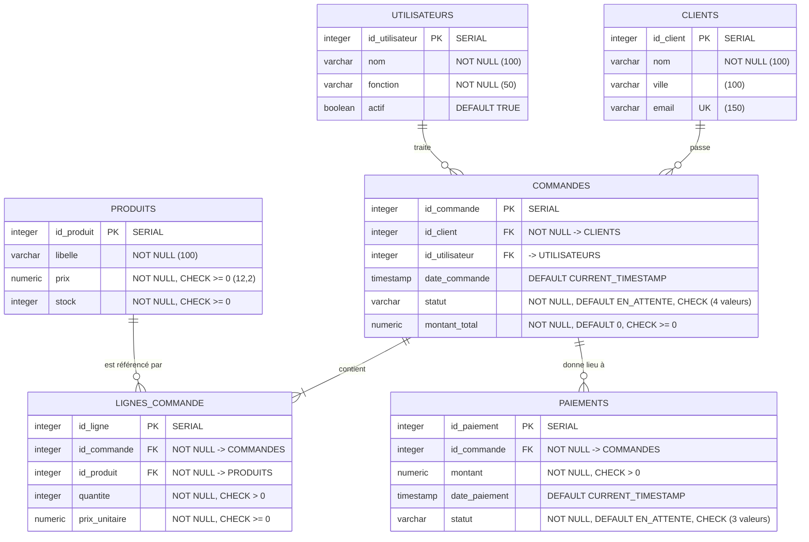
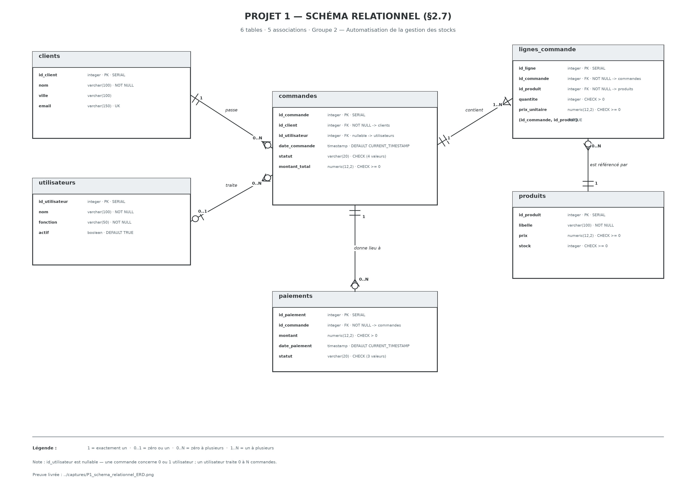

# RAPPORT FINAL — PROJET 1 : PostgreSQL + pgvector
## Groupe 2 — Automatisation de la gestion des stocks

**Niveau : ITT3-IR** | **Examinateur : M. SASSA Giquel** | **Équipe : 5 membres (M1 à M5)**  
**Version du modèle : 1.0 — 23/11/2026** | **Statut : modèle prêt à assembler**

| Code | Membre | Rôle permanent |
|---|---|---|
| **M1** | **KEUMEKA SOKING WILFRIED GULLIT** | **Chef d'équipe : coordination, socle technique commun, assemblage final** |
| M2 | FADIMATOU SAIDOU | Membre : réalisation technique + rédaction de sa partie |
| M3 | NGUEGNI ONGOLO ANTOINE | Membre : réalisation technique + rédaction de sa partie |
| M4 | ABBO ALKAMILA | Membre : réalisation technique + rédaction de sa partie |
| M5 | EVINA MBAHO ERIC | Membre : réalisation technique + rédaction de sa partie |

**Périmètre :** partie commune (I, II, III) + mission spécialisée du **Groupe 2 — Automatisation de la gestion des stocks** (IV, T1 à T10).  
**Livrables :** scripts SQL commentés, captures, rapport, support de présentation (préparé par M5).

---

## Sommaire et répartition actualisée

| Section du sujet | Intitulé | Responsable | Emplacement |
|---|---|---|---|
| **I** | Contexte général | M1 | Rédigé ci-dessous |
| **II.1** | Création de la base de données | M1 | Rédigé ci-dessous |
| **II.2** | Création des tables (2.1 à 2.7) | M1 | Rédigé ci-dessous |
| **II.3** | Insertion des données initiales | M1 | Rédigé ci-dessous |
| **II.4** | Administration des utilisateurs et des privilèges | M2 | `[LOT M2]` |
| **III.5** | Recherche sémantique avec pgvector (5.1 à 5.4 + 8 questions) | M3 | `[LOT M3]` |
| **IV — G2-T1 à T4** | Déclencheurs de gestion automatique des stocks | M4 | `[LOT M4]` |
| **IV — G2-T5, T10** | Tests transactionnels, explication T10, test global | M5 | `[LOT M5]` |
| **IV — G2-T6, T7** | Requêtes jointures et sous-requête | M2 | `[LOT M2]` |
| **IV — G2-T8, T9** | Recherche vectorielle et stocks associés | M3 | `[LOT M3]` |
| Annexes | Captures, scripts, journal de tests | M1 | À compléter |

**Règle d'assemblage :** chaque membre remplace son balisage par son contenu définitif, en conservant les numéros de section du sujet. M1 relit et harmonise la mise en forme finale.

---

## I. Contexte général

Une entreprise dispose d'une plateforme informatique permettant de gérer ses clients, ses produits, ses commandes, ses paiements et ses livraisons. La base de données est administrée sous PostgreSQL. Plusieurs utilisateurs interviennent selon leurs responsabilités : gestion commerciale, gestion des stocks, comptabilité, logistique et supervision.

L'administrateur de bases de données (DBA) doit garantir la sécurité des accès, la cohérence des données, la fiabilité des transactions et le bon fonctionnement des opérations concurrentes. L'entreprise souhaite également intégrer une recherche intelligente permettant de retrouver des produits à partir de leur signification, et non uniquement de mots-clés exacts. Cette fonctionnalité repose sur l'extension **pgvector**.

Le présent rapport couvre la partie commune (création de la base, des six tables, des données, administration des privilèges et recherche sémantique) puis la mission spécialisée du **Groupe 2** : l'automatisation des mouvements de stock au moyen de déclencheurs PL/pgSQL.

---

## II. Partie commune à tous les groupes

### 1. Création de la base de données

La base `entreprise_tp` est recréée de façon **idempotente** par le script socle :

```sql
DROP DATABASE IF EXISTS entreprise_tp;
CREATE DATABASE entreprise_tp;
\c entreprise_tp
```

Le script livré est `Projet1_PostgreSQL/scripts/P1_01_socle_GULLIT.sql` (équivalent du `01_socle.sql` demandé). Il active `\set ON_ERROR_STOP on`, ce qui interrompt l'exécution dès la première erreur et évite une base partiellement chargée. La capture d'exécution est conservée dans `Projet1_PostgreSQL/captures/P1_01_socle_output.txt`.

### 2. Création des tables

Les six tables du sujet sont créées avec l'ensemble de leurs contraintes :

| Table | Clé primaire | Contraintes principales |
|---|---|---|
| `clients` | `id_client SERIAL` | `nom NOT NULL`, `email UNIQUE` |
| `utilisateurs` | `id_utilisateur SERIAL` | `nom NOT NULL`, `fonction NOT NULL`, `actif DEFAULT TRUE` |
| `produits` | `id_produit SERIAL` | `prix >= 0`, `stock >= 0` |
| `commandes` | `id_commande SERIAL` | FK client/utilisateur, `statut IN (...)`, `montant_total >= 0` |
| `lignes_commande` | `id_ligne SERIAL` | FK commande/produit, `quantite > 0`, `prix_unitaire >= 0`, `UNIQUE (id_commande, id_produit)` |
| `paiements` | `id_paiement SERIAL` | FK commande, `montant > 0`, `statut IN (...)` |

#### 2.7 Relations entre les tables



**Diagramme ERD — image haute résolution (§2.7) :**



Fichier : `../captures/P1_schema_relationnel_ERD.png`.

**Les 5 associations :** un client peut passer plusieurs commandes ; un utilisateur fonctionnel peut gérer plusieurs commandes ; une commande peut comporter plusieurs lignes ; un produit peut apparaître dans plusieurs commandes ; une commande peut recevoir plusieurs paiements.

### 3. Insertion des données initiales

Les données du sujet sont insérées **exactement** : 5 clients, 4 utilisateurs, 5 produits, 5 commandes, 10 lignes de commande et 5 paiements. Les séquences `SERIAL` sont resynchronisées après insertion explicite des identifiants.

| Table | Nombre attendu | Nombre obtenu |
|---|---:|---:|
| `clients` | 5 | **5** |
| `utilisateurs` | 4 | **4** |
| `produits` | 5 | **5** |
| `commandes` | 5 | **5** |
| `lignes_commande` | 10 | **10** |
| `paiements` | 5 | **5** |

> **Remarque de contrôle qualité :** la commande n° 3 porte `montant_total = 97 000`, alors que ses lignes totalisent 105 000 (85 000 + 8 000 + 12 000), soit un écart de 8 000. Les données sont conservées telles quelles pour rester conformes au sujet ; ce point doit être signalé dans l'analyse.

### 4. Administration des utilisateurs et des privilèges — `[LOT M2]`

**Responsable : M2 — FADIMATOU SAIDOU** | **Relecteur : M3 — ANTOINE**

Contenu attendu :

- création des 5 rôles : `role_commercial`, `role_stock`, `role_comptabilite`, `role_logistique`, `role_supervision` ;
- création des 5 comptes : `user_commercial`, `user_stock`, `user_comptable`, `user_logistique`, `user_superviseur` ;
- association compte ↔ rôle ;
- privilèges selon le **principe du moindre privilège**, sans `SUPERUSER`, en pensant aux séquences `SERIAL` ;
- tests : deux opérations autorisées et une opération interdite (capture de l'erreur) ;
- explication de la différence entre rôle PostgreSQL, compte de connexion et utilisateur fonctionnel de la table `utilisateurs` ;
- démonstration d'un `REVOKE` et preuve de son effet ;
- **G2-T6** : requête avec jointures affichant les produits et les quantités commandées ;
- **G2-T7** : sous-requête des produits dont le stock est inférieur au stock moyen.

**Fichiers attendus :** `P1_02_privileges_FADIMATOU.sql`, `P1_05_requetes_FADIMATOU.sql`, captures, texte explicatif.

> `[LOT M2]` — remplacer ce bloc par le contenu définitif.

---

## III. Partie commune : Recherche sémantique avec pgvector

### 5. Activation de l'extension pgvector — `[LOT M3]`

**Responsable : M3 — NGUEGNI ONGOLO ANTOINE** | **Relecteur : M2 — FADIMATOU**

Contenu attendu :

- **5.1** vérifier l'installation de pgvector puis `CREATE EXTENSION IF NOT EXISTS vector;` dans `entreprise_tp` ;
- **5.2** ajouter la colonne `embedding VECTOR(3)` à `produits` ;
- **5.3** initialiser les embeddings de démonstration fournis dans le sujet ;
- **5.4** exécuter la recherche par distance cosinus `<=>` et interpréter le classement ;
- rédiger les réponses aux **8 questions** : rôle de pgvector, fonction de `embedding`, signification du vecteur de requête, opérateur `<=>`, classement par distance, différence `LIKE` vs recherche vectorielle, limites des vecteurs à 3 dimensions, rôle du modèle d'IA dans la production des embeddings ;
- **G2-T8** : rechercher les produits similaires à un produit donné avec pgvector ;
- **G2-T9** : afficher les stocks des produits retournés par la recherche vectorielle (jointure avec `produits`).

**Fichiers attendus :** `P1_03_pgvector_ANTOINE.sql`, `P1_06_vectoriel_stock_ANTOINE.sql`, réponses aux 8 questions, captures.

> **Note d'environnement :** l'instance PostgreSQL 18 locale ne dispose pas de l'extension `vector` (`pg_available_extensions` → 0 ligne). Le conteneur Docker `pgvector-tp` (`pgvector/pgvector:pg18`, port 5433) peut être utilisé pour cette partie. Voir `Projet1_PostgreSQL/rapport/P1_schema_relationnel_GULLIT.md` §3.4 pour les commandes exactes.

> `[LOT M3]` — remplacer ce bloc par le contenu définitif.

---

## IV. Missions spécialisées des groupes

### Groupe 2 — Automatisation de la gestion des stocks

#### G2-T1 à T4 — Déclencheurs de gestion automatique des stocks — `[LOT M4]`

**Responsable : M4 — ABBO ALKAMILA** | **Relecteur : M5 — ERIC**

- **T1** : déclencheur qui diminue le stock après insertion d'une ligne de commande ;
- **T2** : adaptation à la modification de quantité (ajuster de la différence entre nouvelle et ancienne quantité) ;
- **T3** : restitution de la quantité au stock lors de la suppression d'une ligne ;
- **T4** : empêcher un stock négatif avec un `RAISE EXCEPTION` clair ;
- fonction PL/pgSQL commentée, explication de `NEW`, `OLD`, `TG_OP`, petit schéma de la logique.

**Fichier attendu :** `P1_04_triggers_stock_ABBO.sql` + explication rédigée + schéma.

> `[LOT M4]` — remplacer ce bloc par le contenu définitif.

#### G2-T5, T10 et test global — `[LOT M5]`

**Responsable : M5 — EVINA MBAHO ERIC** | **Relecteur : M4 — ABBO**

- **T5** : tester les déclencheurs dans des transactions : cas qui réussit (`COMMIT`), cas qui échoue (stock insuffisant puis `ROLLBACK`), modification et suppression ; montrer le stock avant/après ;
- **T10** : expliquer pourquoi deux produits similaires ne sont pas forcément interchangeables et pourquoi la similarité ne garantit pas la disponibilité, en s'appuyant sur les résultats de M3 ;
- **test global** : rejouer tous les scripts dans l'ordre sur une base vierge et signaler les erreurs ;
- préparation du **support de présentation du Projet 1**.

**Fichiers attendus :** `P1_07_tests_transactions_ERIC.sql`, tableau des tests, texte T10, diapositives.

> `[LOT M5]` — remplacer ce bloc par le contenu définitif.

#### G2-T6, T7 — Requêtes jointures et sous-requête — `[LOT M2]`

Voir §II.4 pour le détail. Les requêtes doivent être rejouées sur la base `entreprise_tp` et capturées.

#### G2-T8, T9 — Recherche vectorielle et stocks — `[LOT M3]`

Voir §III.5 pour le détail. Les résultats doivent être cohérents avec les embeddings initiaux et les stocks de la table `produits`.

---

## Annexes

| Annexe | Contenu | Emplacement |
|---|---|---|
| A | Script socle et capture d'exécution | `Projet1_PostgreSQL/scripts/P1_01_socle_GULLIT.sql`, `captures/P1_01_socle_output.txt` |
| B | Schéma relationnel et texte §1-§3 | `rapport/P1_schema_relationnel_GULLIT.md` |
| C | Scripts des lots M2 à M5 | À compléter par chaque membre |
| D | Captures des tests et journal des erreurs | À compléter par chaque membre |
| E | Support de présentation | À préparer par M5 |

---

**Validation M1 :** modèle vérifié et prêt pour l'assemblage. Chaque balise `[LOT ...]` doit être remplacée avant la remise finale.
